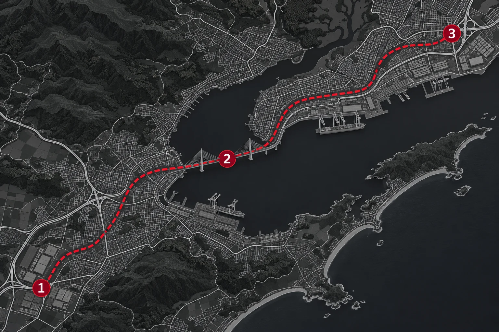

# TracePass

Rastreabilidade de produtos por lote, do fornecedor de origem ao destino. O painel registra o que aconteceu com cada remessa. O passaporte digital reúne esses registros em uma consulta que pode ser compartilhada por link ou QR Code.

[TracePass na Vercel](https://tracepass-enterprise.vercel.app) · [API interativa (Swagger)](https://tracepass-api.onrender.com/swagger-ui/index.html)

*Ilustração da página inicial. O mapa interativo da demonstração usa os locais registrados para o lote.*

## Experimente em três passos

Abra a demonstração pelo botão **Testar o TracePass** na página inicial. O cenário traz uma empresa, um produto, um fornecedor e um lote fictícios. A demonstração roda no navegador e os registros criados ficam nele.

| Passo | Onde ir | O que fazer |
| --- | --- | --- |
| **1. Escolha o lote** | **Lotes** | Use o lote já cadastrado. Para montar outro cenário, cadastre produto e fornecedor na mesma empresa e vincule os dois ao novo lote. |
| **2. Registre um evento** | **Movimentações** | Informe o tipo, o título, o local e o horário. Use o zoom e arraste o mapa para navegar. Clique no local desejado e escolha **Adicionar evento**. |
| **3. Consulte o resultado** | **Lotes → Ver passaporte** | Abra o passaporte do mesmo lote. Confira o evento na jornada e selecione **Destacar no mapa** para localizar o ponto. |

O botão **Ver Passaporte** no topo da demonstração abre uma amostra pronta. Para ver os dados que você acabou de registrar, abra o passaporte do lote correspondente em **Lotes**. Para simular avaria ou outro desvio, entre em **Ocorrências**, escolha o lote e acompanhe o registro até a resolução.

### Corrija ou arquive um registro

Use **Editar** para corrigir empresas, produtos, fornecedores, lotes ou movimentações. **Apagar** arquiva o registro e o retira da lista ativa. Em **Histórico de alterações**, abra um item para comparar os valores anteriores e posteriores ou consultar os dados preservados no arquivamento.

Arquive primeiro os lotes vinculados antes de arquivar um produto ou fornecedor. Para arquivar uma empresa, arquive seus produtos e fornecedores primeiro. O passaporte de um lote arquivado continua acessível para consulta histórica. Eventos de bloqueio e liberação ficam protegidos no histórico de segurança.

## Como os dados se conectam

~~~mermaid
flowchart LR
    E[Empresa] --> P[Produto]
    E --> F[Fornecedor]
    P --> L[Lote]
    F --> L
    L --> M[Movimentações]
    L --> O[Ocorrências, quando houver]
    L --> D[Passaporte digital]
    M --> D
    O --> D
~~~

Produtos e fornecedores podem ser cadastrados em qualquer ordem. O lote identifica a remessa e associa o produto ao fornecedor de origem. As movimentações registram eventos ao longo do tempo. Ocorrências de gravidade alta ou crítica podem acionar bloqueio preventivo.

O mapa conecta os pontos informados em ordem cronológica. A linha pontilhada indica a sequência de registros, sem inferir o caminho rodoviário percorrido. Os números em branco indicam contagens comuns, amarelo sinaliza atenção e vermelho identifica riscos ativos urgentes.

## Arquitetura

~~~mermaid
flowchart LR
    U[Navegador] --> F[React + TypeScript]
    F --> A[API REST Spring Boot]
    A --> P[(PostgreSQL)]
    F --> D[Dados fictícios locais no laboratório]
    F --> M[Cartografia via Leaflet]
~~~

- **Frontend:** React, TypeScript, Vite e Leaflet.
- **Backend:** Java 21, Spring Boot, JPA e Flyway.
- **Dados e hospedagem:** PostgreSQL, Docker Compose para desenvolvimento, Vercel para o frontend e Render para a API.

| Caminho | Conteúdo |
| --- | --- |
| `frontend/` | Apresentação, painel, demonstração e passaporte |
| `backend/tracepass-api/` | API, regras de negócio e migrações |
| `compose.yaml` | PostgreSQL para desenvolvimento local |

## Execute localmente

### Somente a demonstração

Requer Node.js 22.12 ou posterior na série 22, ou Node.js 20.19 ou posterior na série 20. A partir da raiz do repositório:

~~~powershell
cd apps/tracepass/frontend
npm ci
npm run dev
~~~

Abra **http://localhost:5173/laboratorio** para testar operações com dados fictícios ou **http://localhost:5173/demo** para consultar o passaporte de amostra. Essas duas rotas podem ser usadas sem iniciar a API.

### API e banco de dados

Requer Java 21 e Docker com Compose. Em outro terminal, a partir da raiz do repositório:

~~~powershell
cd apps/tracepass
Copy-Item .env.example .env
docker compose up -d
cd backend/tracepass-api
.\mvnw.cmd spring-boot:run
~~~

O Vite encaminha as chamadas da aplicação local para a API na porta `8080`. Em instalações com autenticação administrativa habilitada, configure `TRACEPASS_ADMIN_TOKEN` no backend e informe a chave na interface. Para implantar o frontend em outro ambiente, use `VITE_API_URL` com o endereço da API. Mantenha a chave administrativa fora das variáveis `VITE_*` e dos arquivos versionados.

### Verificações

- No frontend, execute `npm run lint` e `npm run build`.
- No backend, execute `.\mvnw.cmd test` com o ambiente de teste configurado.

## Cartografia

O mapa mundial usa o [OpenStreetMap](https://www.openstreetmap.org/copyright) conforme a [política de uso dos blocos](https://operations.osmfoundation.org/policies/tiles/). Para trocar de provedor, defina `VITE_MAP_TILE_URL` e `VITE_MAP_TILE_ATTRIBUTION` antes do build. Em caso de falha do provedor, os pontos continuam disponíveis e a cartografia de contingência cobre a Grande Florianópolis.

A base de contingência combina limites municipais do IBGE e vias derivadas de © OpenStreetMap contributors. O arquivo `grande-florianopolis-roads.json` é distribuído sob a [Open Database License](https://opendatacommons.org/licenses/odbl/1-0/).

## Autor

Enzo Teixeira Alves · [Portfólio](https://portifolio-enzo-xi.vercel.app/pt)
### Demonstração do portfólio

Entre pelo **Acesso administrativo** e abra **Demonstração do portfólio** para manter os cadastros fictícios publicados em uma base separada. O backend salva cada alteração no PostgreSQL e detecta edições concorrentes. O passaporte em destaque em `/demo` e os links públicos dos lotes publicados leem essa base. Novos visitantes recebem uma cópia para experimentar no navegador em `/laboratorio`. O histórico administrativo, documentos e contatos ficam fora dessa cópia.

A migração V9 importa o lote `ELE-SP-001` do cenário local como primeiro destaque, com os 120 volumes e sem movimentações. Em **Movimentações**, use o mapa ou **Inserir coordenadas manualmente** para registrar os pontos do trajeto.
